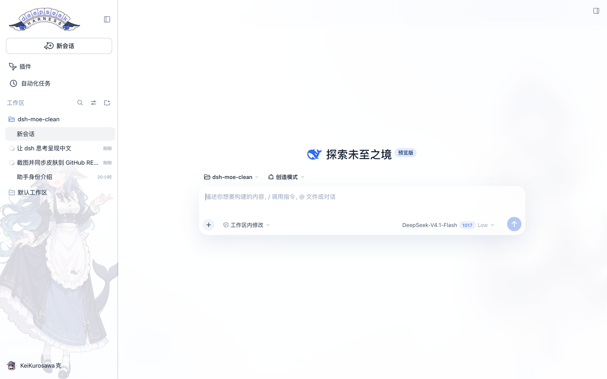
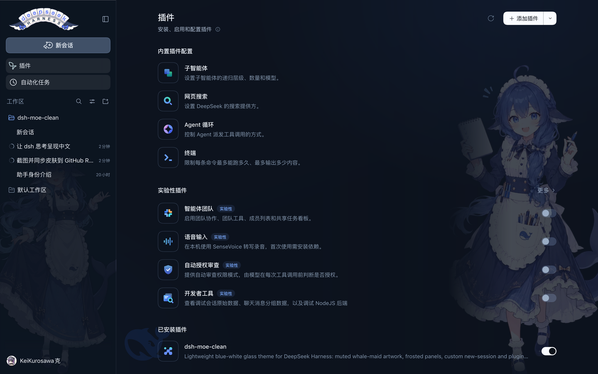
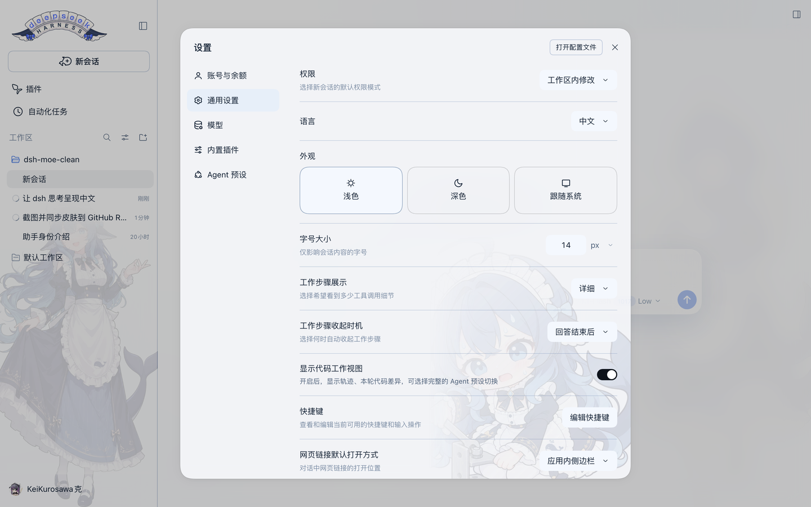
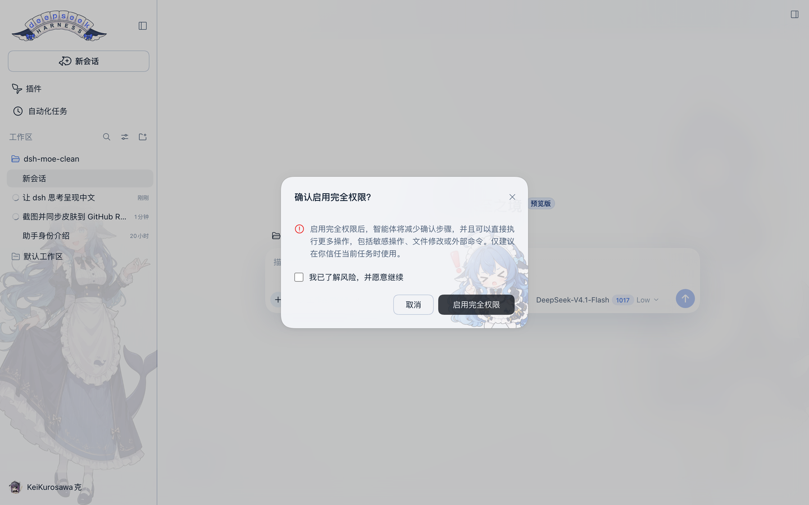
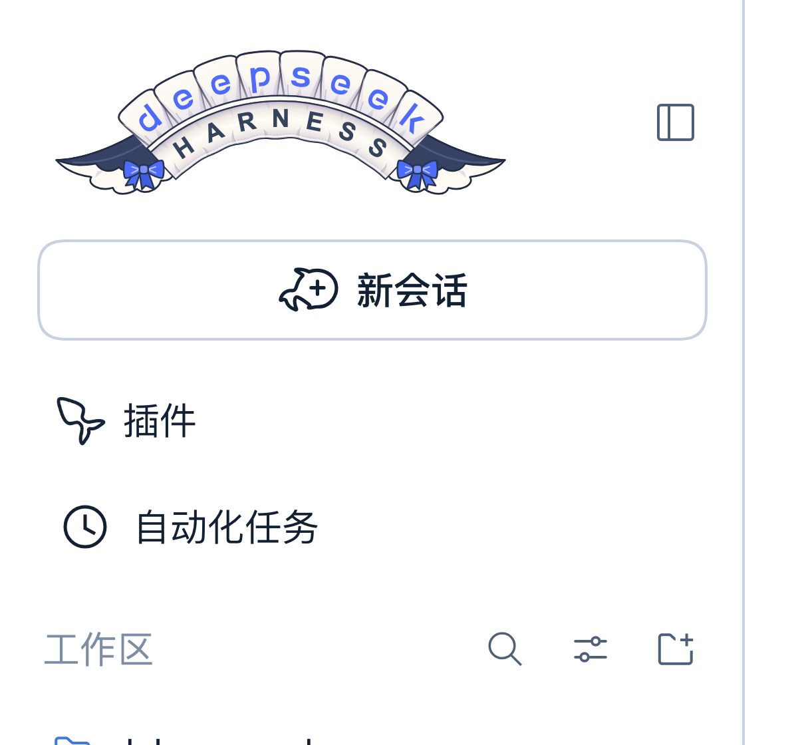

# dsh-moe-clean · 鲸鱼娘轻量皮肤


给 DeepSeek Harness（DSH）的一套安静、轻量的白蓝皮肤：白色为主、DeepSeek 蓝做点缀，侧栏和输入框是毛玻璃，右侧一张做了渐隐的鲸鱼娘女仆立绘。

## 界面

| 亮色 · 新会话 | 暗色 · 插件页 |
| --- | --- |
|  |  |

| 设置弹窗 | 完全权限警告 |
| --- | --- |
|  |  |

## 为什么是轻量

- **无构建、无运行时依赖**：装完即用，不需要 node_modules 里的第三方库；
- **只有 8 个静态资源**：左右两张立绘、两张 Q 版女仆（弹窗底纹 / 完全权限警告）、鲸鱼水印、hover 动图及其首帧、堆叠字标 SVG；
- **纯外观**：CSS 设计令牌 + 少量 DOM 装饰，宿主侧只注册一个只读资源路由；
- **可完整还原**：卸载插件后原生图标、背景和尺寸都会回到原样。

## 特性

- **白 + 蓝**：白色表面、冷蓝灰中性色，全界面只有 DeepSeek 蓝 `#2f6bf0` 一个强调色；
- **毛玻璃**：只用在侧栏和输入框（`backdrop-filter`），正文区保持通透；设置等弹窗是 86% 冷白 `rgba(250,252,255,.86)` + `blur(44px)` 的乳白磨砂面，不再透出背后的正文；
- **右侧鲸鱼娘**：默认 60%、暗色 72% 不透明度，左侧与底部用渐变蒙版淡出，右侧再加一层冷色雾化，压字不挡字；
- **左侧栏底纹**：另一张女仆立绘铺在侧栏底部，收起成图标栏时自动隐藏；
- **鲸鱼水印**：左下角一枚 20% 不透明的 DeepSeek 鲸鱼，窄窗口自动隐藏；
- **堆叠字标**：顶栏整块锁屏换成一张手绘双层蕾丝缎带 SVG——deepseek 在上、HARNESS 在下，两侧各一个蓝蝴蝶结；
- **蓝色字标**：缎带上的 deepseek 仍是 DeepSeek 蓝，HARNESS 用深墨色；暗色下靠白色缎带保持对比；
- **插件图标 hover 动效**：平时显示 GIF 的第一帧（22px 静态图），鼠标移上去才播放摇摆动画，移开回到第一帧；暗色自动反相；
- **弹窗女仆**：设置/登录等弹窗右下角一枚 40% 透明（烘焙进立绘）的 Q 版女仆，58% 宽，贴着圆角往外压一点、被裁掉少许；蒙版沿左上→右下方向 135° 淡出，不留方形边缘；
- **完全权限警告**：只有「确认启用完全权限」这个风险弹窗换成另一张会指人的 Q 版女仆——40% 透明、42% 宽，往右下角压得更深（尾巴和鞋被弹窗边缘裁掉），伸出的食指正好落在按钮上方；确认按钮的禁用态也从 40% 提到 80%，指人的女仆不会从按钮文字里透出来；
- **弹层不透明度下限**：下拉菜单、popover 统一提到 94%；输入框上方的斜杠 / 命令面板直接改成**实心**（亮 `#ffffff` / 暗 `#263040`），背后的对话正文一点不透；
- **输入框底衬**：输入框底部的渐隐换成 60% 毛玻璃 + 20px 模糊（亮 `rgba(255,255,255,.6)` / 暗 `rgba(13,20,31,.6)`），最后一条消息不再从统计条后面透出锐利文字；
- **自定义图标**：「新会话」换成鲸鱼气泡加号，「插件」换成鲸尾，导航尺寸统一；
- **亮暗跟随**：不需要手动切换，沿用 DSH 的 `data-ds-dark-theme`。

侧栏字标与图标：



## 安装

### 桌面版

侧栏「插件」→「添加插件」，填入：

```text
github:KurosawaGeeker/dsh-moe-lite
```

安装后**重启一次 DSH**。

### CLI（web profile）

```sh
dsh plugin --profile web add 'github:KurosawaGeeker/dsh-moe-lite'
```

装完重启 `dsh web`，刷新页面。

### 本地目录 / tarball

```sh
git clone https://github.com/KurosawaGeeker/dsh-moe-lite dsh-moe-clean
dsh plugin --profile desktop add ./dsh-moe-clean
# 或
npm pack && dsh plugin --profile desktop add ./dsh-moe-clean-0.15.0.tgz
```

> 桌面版由应用管理自己的 `desktop` profile，用 `web` profile 的命令不会装到桌面版里。

## 兼容性

| DSH | 状态 |
| --- | --- |
| `0.2.1-rc.2` | 实测（桌面版 / web） |
| 其它 `0.2.x` | 未实测，图标选择器依赖 aria-label |

只用到了 CSS 变量、`data-*` 属性和按钮的 `aria-label`，不触碰内部类名哈希。DSH 改版后如果图标没被替换，通常是 aria 文案变了，改一下 `lib/client.js` 里的正则即可。

## 自定义

立绘浓度、玻璃强度、图标大小都是普通 CSS，可以在自己的补丁层里覆盖：

```css
/* 右侧立绘更淡 */
.dsh-moe-maid { opacity: 0.42; }

/* 侧栏底纹小一点 */
[class*="sidebarCol"] { background-size: 92% auto !important; }

/* 新会话图标再大一点 */
svg[data-moe-chat-icon] { width: 26px !important; height: 26px !important; }
```

## 卸载

插件页卸载，或：

```sh
dsh plugin --profile desktop remove dsh-moe-clean
```

立绘、水印、图标和毛玻璃会一并移除，原生界面恢复。

## 目录结构

```text
dsh-moe-clean/
├─ package.json          # dsh.bundle.patch + dsh.client
├─ cordis.patch.yml      # 单个 entry：ui-moe-clean
├─ lib/
│  ├─ index.js           # 宿主：只读资源路由 /api/dsh-moe-clean/assets
│  └─ client.js          # 浏览器：主题 CSS + 立绘 + 图标替换
├─ assets/
│  ├─ maid-left.webp     # 侧栏底纹
│  ├─ maid-right.webp    # 右侧立绘
│  ├─ whale.svg          # 左下角鲸鱼水印
│  └─ deepseek-harness-maid-stacked.svg  # 顶栏堆叠字标
├─ docs/0.15.0/          # README 截图（按版本归档）
├─ LICENSE               # MIT（代码）
├─ LICENSE-ARTWORK       # CC BY-NC-SA 4.0（美术）
└─ NOTICE                # 署名链
```

## 从 0.1 到 0.15

- **0.1**：暖米色极简主题，去掉原版皮肤的巴洛克装饰；
- **0.2**：加入毛玻璃和右侧立绘，立绘 60% 渐隐；
- **0.3**：整体改成白 + 蓝，侧栏铺女仆底纹，加入鲸鱼水印；
- **0.4**：按实际截图修布局——侧栏底纹按宽度缩放、整身可见、收起时隐藏；窄屏和暗色单独验证；加号居中到身体重心；
- **0.5**：接入「新会话」鲸鱼气泡图标（替换原生 16×16 图标，Observer 防回退）；
- **0.6**：接入「插件」鲸尾图标，导航图标统一到 20px，「新会话」24px；
- **0.7**：弹窗（设置、登录等）从半透明改成磨砂玻璃，`blur(44px)` + 55% 底色，不再透出页面正文；
- **0.8**：弹窗右下角加入 Q 版女仆水印（17% 透明、渐变淡出）；
- **0.9**：「插件」图标 hover 时播放摇摆 GIF；
- **0.11**：静止态改为 GIF 的首帧，不再用线框 SVG；
- **0.11.3**：弹窗女仆贴到右下角、允许被圆角裁掉少许，渐隐改成一条 135° 对角蒙版；
- **0.12**：HARNESS 徽章换成手绘蕾丝缎带 + 蓝蝴蝶结；弹窗女仆提亮并往右下角压得更深；
- **0.13**：弹窗改成 72% 冷白乳白面，斜杠 / 命令面板改成实心，完全权限警告单独换成会指人的 Q 版女仆，输入框底部加 60% 毛玻璃；
- **0.14**：浮层透明度审计——菜单 / 弹层回到 94%，弹窗提到 86%（暗色 80%），hover 预览卡不再透字；完全权限确认按钮的禁用态提到 80%；
- **0.15**：顶栏换成 deepseek + HARNESS 双层蕾丝缎带字标，原来的鲸鱼 + 字标 + 徽章组合与 `harness-banner.webp` 一并移除。

## 许可与署名

- **代码**：MIT，见 [LICENSE](LICENSE)；
- **美术资源**：CC BY-NC-SA 4.0，**禁止商业使用**，署名链见 [NOTICE](NOTICE)：
  1. **一创 上善** —— 鲸鱼娘角色形象原作（[Pixiv](https://www.pixiv.net/users/62155430)）；
  2. **二创 ZipZipPipe** —— 加入 DeepSeek 元素的女仆鲸鱼娘（[Pixiv](https://www.pixiv.net/users/18604994)）；
  3. **三创 Small-tailqwq** —— [dsh-deep-whale](https://github.com/Small-tailqwq/dsh-deep-whale) 皮肤中的立绘整理；
- **图标**：鲸鱼气泡与鲸尾图标由仓库作者基于 DeepSeek 元素改造；左下角水印使用 DeepSeek 鲸鱼标识。

本项目与 DeepSeek 官方无关。
